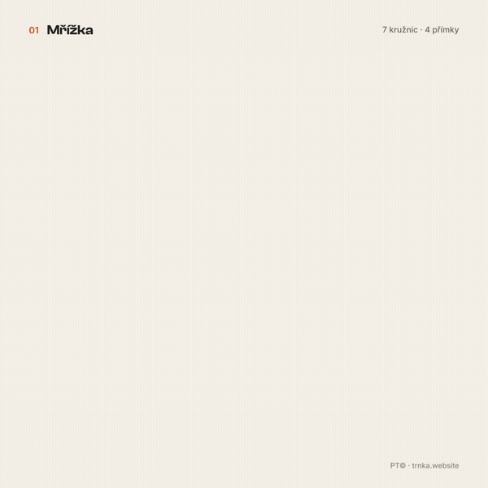
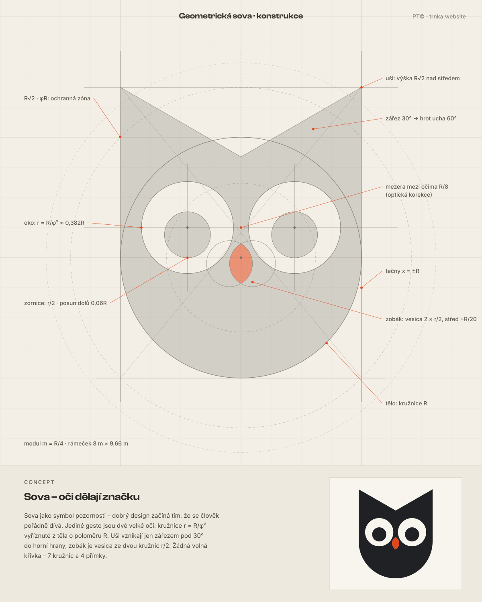
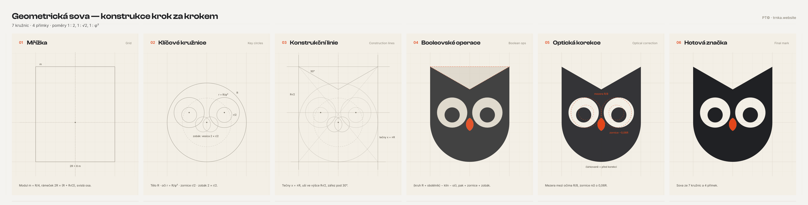
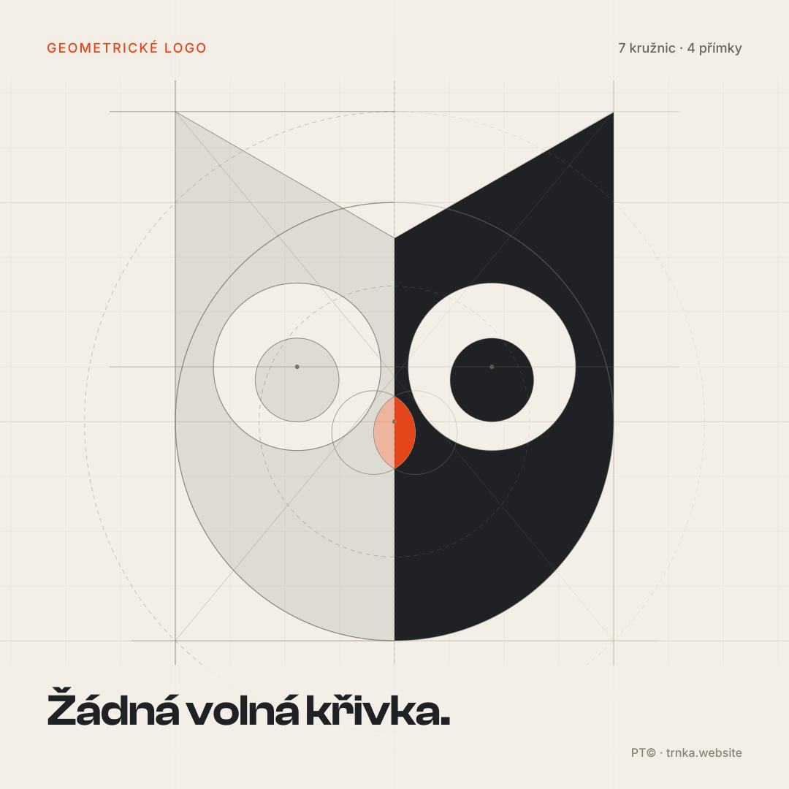
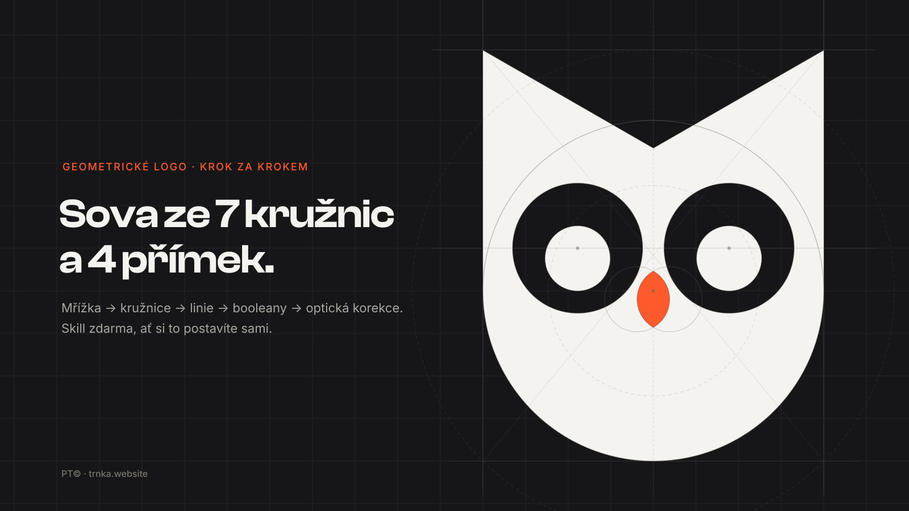
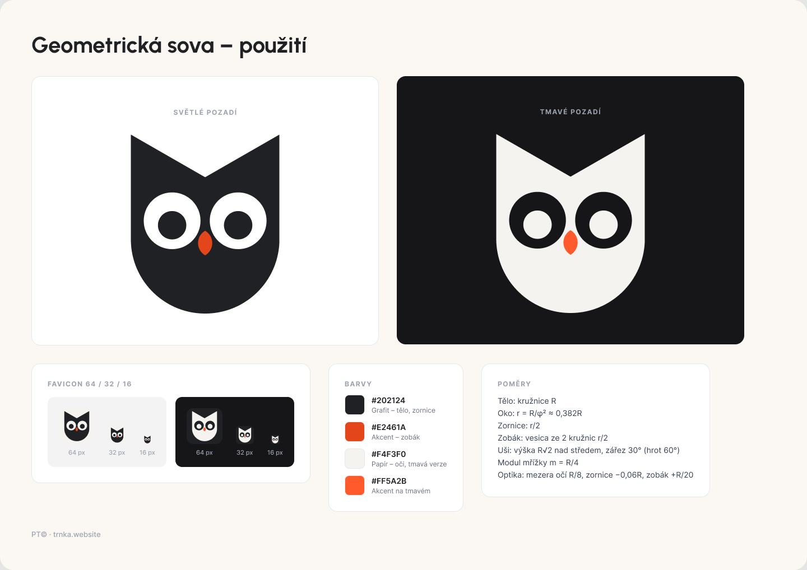

# Geometric Logo Construction

A reusable AI-agent skill for designing logo marks from circles and straight lines only, with deliberate ratios (1:2, 1:√2, 1:φ, Fibonacci). Each mark is presented on a construction sheet showing the full geometric foundation—grid, construction circles, ratio labels, and concept block. Inspired by Rikyu-style geometric construction, the method ensures every curve has a reason and anyone can redraw the mark from the sheet.



## Example gallery: Owl mark

<table>
<tr>
<td></td>
<td></td>
</tr>
<tr>
<td></td>
<td></td>
</tr>
<tr>
<td colspan="2"></td>
</tr>
</table>

## How to use

1. **With Cursor or other AI agents:** Drop `SKILL.md` into your agent's skills folder, or paste its contents into any AI assistant prompt.
2. **Starter prompt:** Use this template from `SKILL.md`:

```
Design a geometric logo mark of [MOTIF] for [BRAND / USE].
Follow the geometric-logo-construction method:
1. Write a 2–4 sentence concept with ONE dominant gesture.
2. Set a modular grid (module = R/4) and a bounding box.
3. Build every curve from 3–8 circles with ratios from 1:2, 1:√2, 1:φ, 1:φ², Fibonacci;
   use straight lines only at 30/45/60° or as tangents. List every circle (centre, radius, ratio).
4. Make the filled mark with boolean union/subtract/intersect only, as real vector paths
   (SVG <path> or Figma vector), no icon fonts or stock icons.
5. Apply optical corrections and list each deviation with its value.
6. Produce a construction sheet (1200×1500, off-white grid paper #F3EFE6, thin grey circles
   and lines over the faint filled mark, ratio labels outside the mark with leader lines,
   CONCEPT block, clean mark in a box).
7. Produce applications: large, light and dark, favicons at 64/32/16 px.
8. Export PNGs, inspect them (16 px legibility, accidental shapes, label collisions), fix, re-export.
Colours: [PRIMARY], [ACCENT], [BACKGROUND]. Output: SVG files + PNG previews (+ Figma frames if available).
```

## The method (summary)

1. **Concept first:** Write 2–4 sentences defining one dominant gesture before drawing anything.
2. **Modular grid:** Pick a base unit R and a grid module (R/4, R/6 or R/8). Fix the bounding box and axes.
3. **Primitives:** Derive every curve from 3–8 circles with deliberate ratios. Use straight lines for tangents and angles of 30°, 45° or 60°.
4. **Boolean shapes:** Build the filled mark only from unions, subtractions and intersections of those primitives.
5. **Optical correction:** Correct geometry on purpose and document every deviation.
6. **Construction sheet:** Present the result on one sheet with construction circles, lines, ratio labels, concept block and clean mark.
7. **Applications:** Large size, light/dark backgrounds, one-colour version, favicons at 64/32/16 px.
8. **Self-check:** Export PNGs and verify legibility, weight consistency and label placement.
9. **Recommend:** Mark one variant as recommended and give the reason.

## Ratio cheat-sheet

| Ratio | Value | Typical use |
|---|---|---|
| 1 : 2 | 0.5 | pupil in an eye, inner and outer ring, half-module details |
| 1 : √2 | 0.707 / 1.414 | the diagonal of a square; height of points, ears, peaks |
| 1 : √3 | 0.577 / 1.732 | the 30/60° triangle; vesica height (two circles of r, centres r apart) |
| 1 : φ | 0.618 / 1.618 | main secondary circles, protection zone |
| 1 : φ² | 0.382 / 2.618 | small features inside a large form, e.g. eyes in a body |
| Fibonacci | 3 : 5, 5 : 8, 8 : 13 | proportions of the bounding box, stroke-to-size |
| Angles | 30°, 45°, 60° | cuts, notches, tangents, beaks, tails |

**Rules of thumb:**
- Use no more than **3 different ratios** in one mark.
- The **vesica piscis** (intersection of two equal circles) makes a perfect leaf, beak, eye or flame.
- A circle tangent to two lines gives an exact rounded corner.

## Download

Get the complete package (skill file, README, examples) from the [latest release](https://github.com/trnkapavel/geometric-logo-construction/releases/latest):

- [geometric-logo-construction-v1.0.0.zip](https://github.com/trnkapavel/geometric-logo-construction/releases/download/v1.0.0/geometric-logo-construction-v1.0.0.zip)

## Credits

Made by **Pavel Trnka**  
Website: [https://www.trnka.website/](https://www.trnka.website/)  
X: [@fromen](https://x.com/fromen)

## License

- The skill text (`SKILL.md`) and documentation are licensed under the **MIT License** (see `LICENSE`).
- The owl example artwork in `examples/` is licensed under [**CC BY 4.0**](https://creativecommons.org/licenses/by/4.0/) (Creative Commons Attribution 4.0 International).
